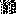
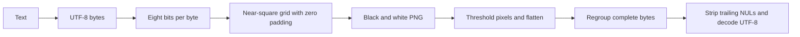

<div align="center">

# MessageInPicture

**Turn a text message into black-and-white pixels—and read it back.**

A small experiment in seeing text as data: UTF-8 bytes become a PNG, one bit per pixel.

[](binToImage.py) [](requirements.txt) [](requirements.txt)

[**Try a round trip**](#try-a-round-trip) · [**Read the pixels**](#from-characters-to-pixels) · [**Limits**](#what-the-format-does-and-doesnt-preserve)

</div>

## The picture is the message

Images and text are both bytes, but they are usually treated as different kinds of files. This experiment makes that relationship visible: turn each UTF-8 byte into eight black/white pixels, arrange them into a near-square grid, and reverse the process to recover the text.

| Message | Actual encoded PNG | Decoded output |
| --- | :---: | --- |
| `café ✓ नमस्ते` |  | `café ✓ नमस्ते` |

*The original PNG is tiny and enlarged here for display. Download [the original file](docs/images/message.png) to decode it; a screenshot or resized copy changes its pixel data.*

> [!NOTE]
> **This is encoding, not encryption or steganography.** There is no cover image, secret key or hidden payload. Anyone with the decoding procedure can read the message. It is an early learning experiment, not a secure messaging format.

## Try a round trip

Use Git and Python; Python 3.13 is the verified environment. OpenCV and NumPy run locally, with no API key or external service.

```sh
git clone https://github.com/Muneer320/MessageInPicture.git
cd MessageInPicture
python -m pip install -r requirements.txt
```

Run this Python example from the repository root:

```python
from binToImage import binToImg, imgToText

message = "café ✓ नमस्ते"
binToImg(message, "message.png")
decoded = imgToText("message.png")
print(decoded)
assert decoded == message
```

Expected output:

```text
café ✓ नमस्ते
```

For prompts instead of imports, run `python binToImage.py`, then choose `i` to encode or `ii` to decode. Finish multiline input with Ctrl+Z then Enter on Windows or Ctrl+D on macOS/Linux. The default output is `binary_image.png`.

## From characters to pixels



Black represents `0`; white represents `1`. Encoding uses `floor(sqrt(bit_count))` rows and enough columns to fit the payload. Decoding thresholds grayscale values at 127, reads row by row and regroups bits into bytes.

## What the format does and doesn't preserve

| Works | Boundary |
| --- | --- |
| Ordinary UTF-8 text, including multiline and non-ASCII messages | Trailing NUL characters are removed with padding; arbitrary byte payloads are not preserved |
| Lossless PNG pixels | Resizing, cropping, threshold changes or lossy conversion can corrupt the data |
| A simple encode/decode experiment | No length header, checksum, encryption or authenticity check |

The writer uses PNG compression level 0. PNG's lossless compression itself does not corrupt the payload; preserving the exact pixels matters. Empty messages are rejected. A wrong/corrupted image may fail UTF-8 decoding or produce unrelated valid text. Large messages allocate the bit string and pixel array in memory.

<details>
<summary><strong>Batch decoding and the bundled word-list experiment</strong></summary>

```sh
python convert_words.py docs/images/message.png
python convert_words.py --encode-wordlist
```

The first command prints decoded text and its character count. The second encodes the bundled `words_alpha.txt` to `wordlist.png`; it is a bulk experiment and can use substantially more memory. Run these from the repository root so the relative word-list path resolves.

</details>

## Tests and source map

```sh
python -m pip install pytest
python -m pytest tests
```

| File | Role |
| --- | --- |
| [binToImage.py](binToImage.py) | Encoding, bit extraction, UTF-8 decoding and interactive menu |
| [convert_words.py](convert_words.py) | Batch decode or bundled word-list encode |
| [tests/](tests/) | ASCII/multiline/Unicode/long-input round trips and invalid inputs |

For a bug, include a small synthetic input and reproduction in [Issues](https://github.com/Muneer320/MessageInPicture/issues). For a focused PR, run the tests and check padding/Unicode behavior; never attach private messages assuming the encoding conceals them.

An early experiment by [Muneer Alam](https://github.com/Muneer320), retained for the idea and the lessons. The repository does not currently include a license file.
